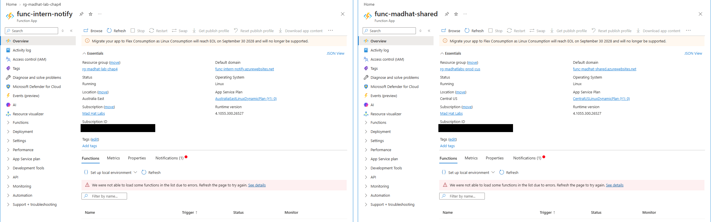
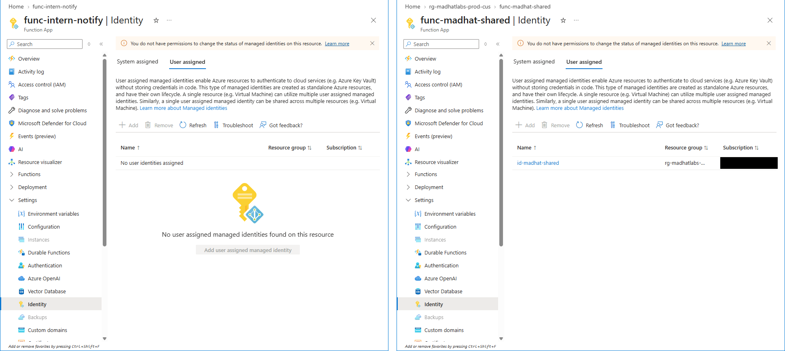
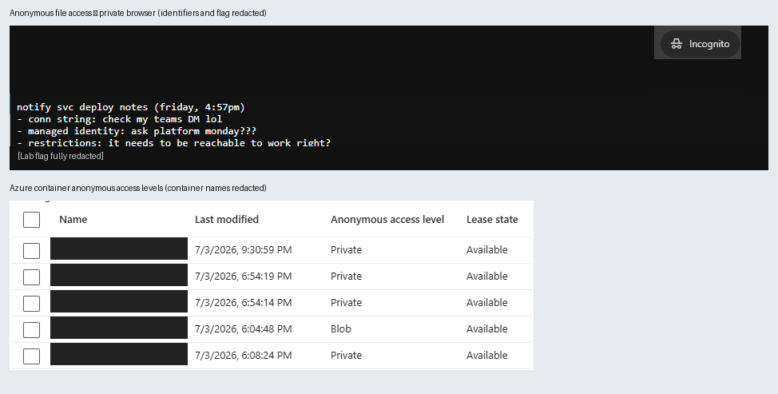
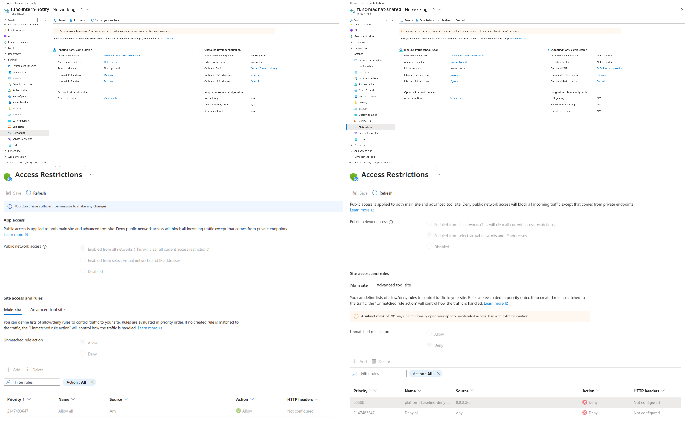

# Week 4: The Friday Deploy, a Pre-Production Deployment Review

## TL;DR
- **Fix today:** Close the public storage container so nobody can read its files.

- **Why it's first:** It's the only exposure that's live right now. The other three are design or hygiene gaps that need fixing but aren't leaking anything yet.

- **Everything else:** Design a managed identity this sprint, fix the region on the next deploy, and add the access rule in that same change.

- **30-second director version:** "The new app is leaving a file of internal notes open to anyone on the internet. We're closing that today. The other problems are setup mistakes that we'll fix in the next few weeks before the app goes live."

## Context and Scope
- **What:** A new serverless notification service (an Azure Function App) deployed Friday at 4:57 PM into a lab resource group.
- **Why reviewed:** It hadn't been reviewed before promotion to production.
- **My access:** Reader only, so I could look but not change anything.
- **My role:** Reviewer acting as the senior engineer signing off on the intern's app before it goes to production.

## Method
- There was no written standard, so I **derived the standard from the working system**. I compared the new deployment against a healthy production service that does the same job.
- I reviewed five areas: the Where, the Who, the Leak, the Door, and the Call.
- Where a setting suggested a risk, I **proved it rather than assumed it**.

## 1. The Where: Is it even in the right place?
- **What I observed:** The function app was deployed in Australia East, while the production stack and the data it depends on live in Central US, a different region and a different country.
- **How I verified it:** I compared the Location field on the Overview page of the new app and the production function app. Production runs in Central US. The new app's App Service plan and storage account were also in Australia East.
- **Why it matters:** Every call between this app and the rest of the platform has to travel between two locations thousands of miles apart, which adds latency to every request. It also costs money: Azure doesn't charge for data coming into a region (ingress), but it does charge for data leaving one (egress), so every response is billed.
- **Fix:** Redeploy the app, its plan, and its storage into the platform's standard region, Central US.

## 2. The Who: How does it authenticate?
- **What I observed:** The new function app has no managed identity, system- or user-assigned, while production uses a user-assigned identity.
- **How I verified it:** I looked in the Identity blade of the intern app and checked both the System Assigned and User Assigned tabs and found no managed identity attached in either of those locations. The User Assigned tab of the production app had a User Assigned managed identity attached.
- **Why it matters:** Stored credentials can leak into config files, code, log files, repos, etc. Because a stored credential never expires or rotates on its own, it keeps working until someone notices the unauthorized access. A managed identity has no secrets to leak.
- **Fix:** Attach a user-assigned managed identity with a scoped role on the storage account, then remove the stored credential.

## 3. The Leak: Where does its data actually sit?
- **What I observed:** A storage container was configured for anonymous access.
- **How I verified it:** I opened the blob (file) inside the container and copied its URL. I opened that URL in a private browser window, and the file loaded with no sign-in required.
- **Why it matters:** This is a confirmed, public exposure. Anyone with the URL can read the data in this container. The exposed deployment notes referenced a connection string shared through an internal chat, highlighting unsafe credential handling.
- **Fix:** Immediately set the container to private and then check what was exposed and for how long.

## 4. The Door: Who can reach it?
- **What I observed:** The intern app allows public access from all networks with no access restrictions, and unmatched traffic is allowed.
- **How I verified it:** I checked Access restrictions under the Networking blade on the Main site tab of both apps. The intern app has no rules, and its catch-all allows all traffic. Production has one deny rule blocking all addresses, and its catch-all denies unmatched traffic.
- **Why it matters:** Anyone on the internet can reach this app's endpoint, even though it only runs scheduled jobs and never needs inbound traffic.
- **Fix:** Add a single deny rule, matching production. Once any rule exists, App Service treats unmatched traffic as an implicit deny.

## 5. The Call: What gets fixed today?
**My rule: exposure beats hygiene, and active beats potential.**

| Rank | Finding | Type | When | Why this rank |
|---|---|---|---|---|
| 1 | Public storage container | Active exposure | Today | Anyone on the internet can read it right now |
| 2 | No managed identity | Hygiene gap (design flaw) | This sprint | Needs a code change to fix |
| 3 | Wrong region | Hygiene gap | Next deploy | Costs latency and money, but exposes nothing |
| 4 | Open front door | Hygiene gap | Same PR as the region fix | Bad hygiene, but nothing routes to the app yet |

An active exposure always beats hygiene and "best practices." The storage container is publicly accessible right now. While the other issues do need to be fixed as soon as possible, we need to deal with current issues before we deal with potential issues. The missing identity comes next because it requires a code change, the region can be fixed on the next deploy, and the inbound rule goes into that same change since nothing routes to the app yet.

## Recommendations
1. Close the public container today, then check what was exposed and for how long.
2. Attach a user-assigned managed identity with a scoped storage role, and remove the stored credential.
3. Redeploy into the standard region.
4. Add one inbound deny rule.
5. **My addition:** Add a pre-deploy checklist and run it before anything goes to production. It compares a new deployment against the production baseline, verifying region, managed identity, container access level, and inbound access rules. Each of these four issues would have been caught in minutes, before the deploy instead of after.

## What I Learned
1. **If there's no identity, look for a secret.** An app that reaches storage without a managed identity still has to log in somehow, which usually means a key stored somewhere it can leak (a repo, an environment variable, a log). Now when I see a missing identity, I go looking for the credential.
2. **Prove the exposure before you rank it.** A setting that looks risky is only a guess. Opening the blob in a private window showed that anyone could read it right now. That turned it from a hygiene issue into an active exposure.
