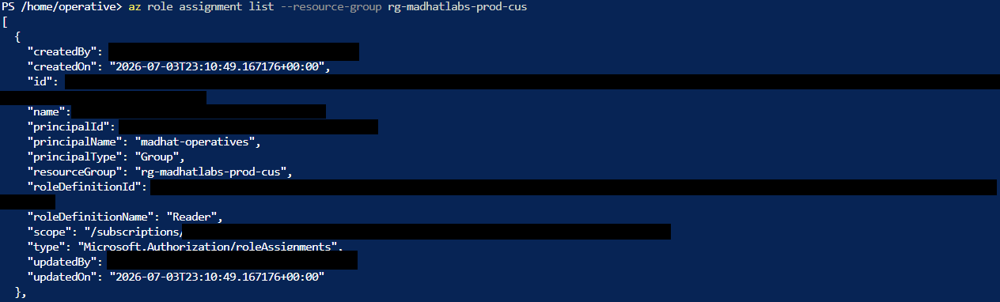
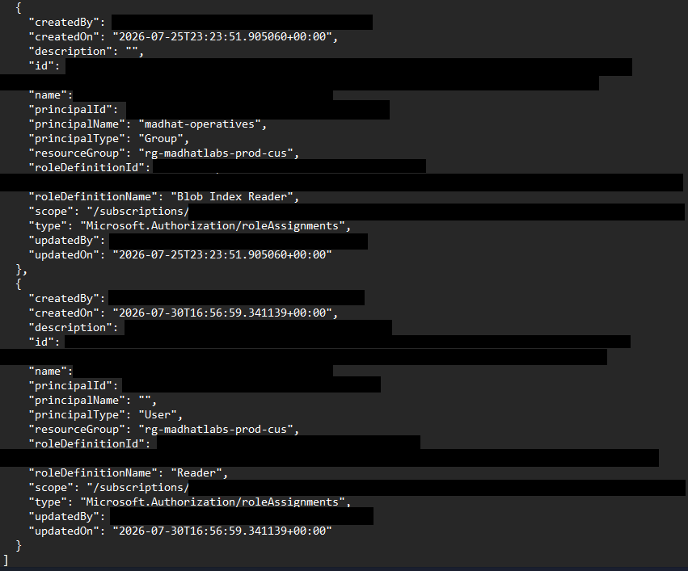
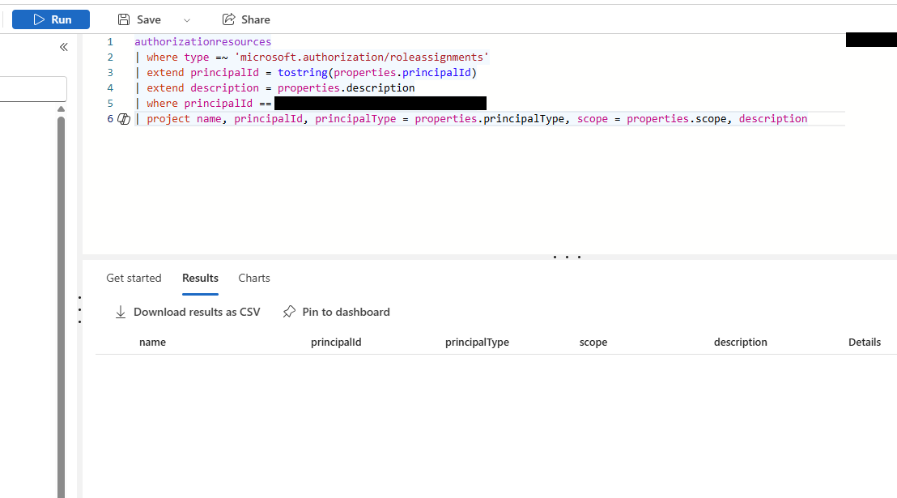
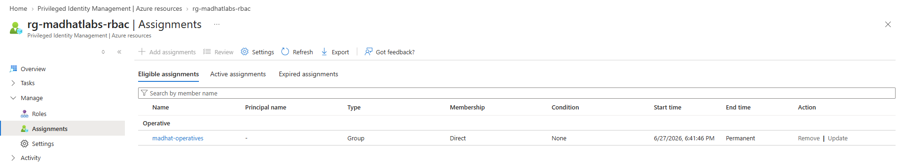
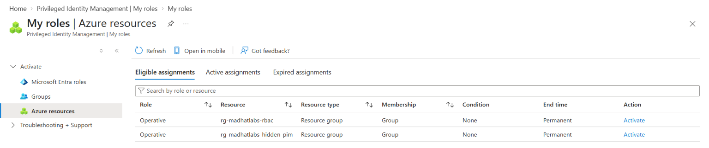
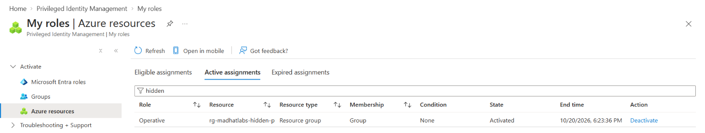
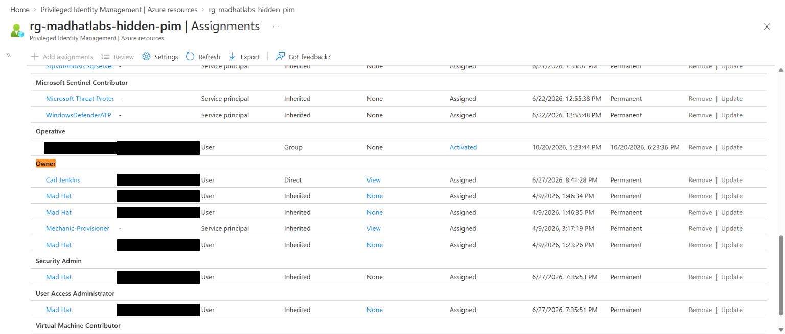

# The Privilege Audit

*Auditing Azure RBAC five ways, and what each method can't see*

## Scenario

After a previous incident, the management board asked for a fresh look at who can do what in the Azure tenant. This was an audit, not incident response: the job was to document, not fix. I worked through the tenant as an auditor reporting to a CISO, recovering five findings the security team had flagged: four with a different audit method each, and a final hunt that combined them.

The audit covered Azure RBAC only. Microsoft Entra directory roles were out of scope.

## Scope and methodology

- **Environment:** Live multi-user Azure training tenant (Mad Hat Labs).
- **My access:** Reader, through the madhat-operatives group, plus one PIM-eligible custom role (Operative) that I activated for the final stage.
- **Methods:** The Access control (IAM) role assignment export, the Azure CLI in Cloud Shell, Azure Resource Graph with KQL, and Privileged Identity Management (PIM). The final stage combined all four.
- **Evidence:** The course owner provided two exports, because my Reader account couldn't resolve principal names. I ran all live checks myself on October 20, 2026.
- **Redactions:** Subscription IDs, object IDs, sign-in names, role assignment descriptions, and flag values are redacted throughout.

## Investigation

### Stage 1 — Access control (IAM): the baseline export

I started with the no-tooling baseline: the role assignment export from Access control (IAM), pulled at the subscription with child scopes and inherited grants included. Of its 182 rows, one user account stood out with 64 Owner assignments: one at the subscription and 63 on individual resource groups, all assigned directly rather than through a group. The next-highest principal held 3.


The 63 resource-group grants add nothing while the subscription-level Owner exists, but they survive its removal. Each is a separate assignment, so cleaning up the obvious one would still leave Owner on 63 resource groups. All 63 followed the same resource group naming pattern and shared an identical description, which is consistent with a script but not proof of one. If the writes fall within the Activity log's 90-day retention, it could confirm this: one Caller, with the writes seconds apart.

**Blind spot:** Across all 182 rows, groups appear as single rows without their members (5 group rows), and no orphaned assignments appear (no unresolved names or Unknown types), even though Stage 2 found one.

### Stage 2 — Azure CLI: the orphaned assignment

The CLI returns the same data as the export, but it's scriptable and repeatable. I ran it in Cloud Shell against the production resource group:

```
az role assignment list --resource-group rg-madhatlabs-prod-cus
```

The output surfaces fields the portal buries, like createdBy, createdOn, and description. By default, it returns only assignments made at that exact scope, so inherited grants need `--include-inherited`.



Role assignments store only the principal's object ID, and the CLI resolves principalName with a separate Entra lookup, so a deleted principal comes back with an empty name. Cross-referencing my CLI output with the course-provided JSON export, I found one: a Reader assignment on the production resource group for a deleted user account. The permission outlived the identity.



**Blind spot:** One exact scope per run, unless you widen it with `--include-inherited` or `--all`. Names also depend on whether your account can complete the Entra lookup.

### Stage 3 — Azure Resource Graph: one query, every subscription

Where the first two methods work one scope at a time, Resource Graph covers every subscription you can read in a single query. I swept the authorizationresources table for any assignment tied to the orphaned principal:

```kusto
authorizationresources
| where type =~ 'microsoft.authorization/roleassignments'
| extend principalId = tostring(properties.principalId)
| extend description = properties.description
| where principalId == '<orphaned principal ID>'
| project name, principalId, principalType = properties.principalType, scope = properties.scope, description
```

The query returned no results. Resource Graph only returns what the caller can read, so an empty result from a restricted account doesn't prove the access is gone.



**Blind spot:** Active assignments only, not eligible ones, and object IDs instead of names.

### Stage 4 — PIM: eligible vs. active

The first three methods only show active access. PIM is the only method here that separates eligible from active, so I reviewed and exported the assignments for rg-madhatlabs-rbac.



The export listed 31 assignments: 1 eligible (the custom Operative role, for madhat-operatives) and 30 active, all with an end time of "Permanent." Nothing in that scope was set to expire, including an administrator account's active Owner and User Access Administrator assignments. PIM also listed the roles Defender for Cloud assigns to its own service principals, which almost certainly weren't made through PIM, as active and permanent.

**Blind spot:** PIM's controls only apply to access that goes through PIM. A standing assignment made outside it never gets activated, so it never needs MFA, a justification, or a time limit, and it leaves no activation record.

### Stage 5 — The hunt: an Owner nobody was watching

The final stage had no instructions: find an over-provisioned account assigned Owner on a hidden resource group.

**Activate.** My roles in PIM showed two eligible Operative assignments through my group, one of them on rg-madhatlabs-hidden-pim. None of my earlier methods had surfaced that resource group. I activated only that role, for one hour, with a justification written for the audit trail. Its end time was the only one in the entire audit that wasn't "Permanent."





**Discover.** I adapted my Stage 3 query to list every assignment on the hidden resource group, and added each assignment's role definition ID:

```kusto
authorizationresources
| where type =~ 'microsoft.authorization/roleassignments'
| extend principalId = tostring(properties.principalId)
| extend description = properties.description
| where resourceGroup =~ 'rg-madhatlabs-hidden-pim'
| project name, principalId, principalType = properties.principalType, scope = properties.scope, description, roleDefinitionId = properties.roleDefinitionId
```

It returned three user assignments: two Operative assignments made through PIM, including my activation, and one Owner, which I identified by its built-in role ID (8e3af657-…). PIM had written my justification into my assignment's description. The other Operative assignment's justification was a single emoticon: PIM can require a justification, but it can't make anyone write a useful one.

**Dig.** The CLI couldn't resolve the users' names either, but its full output showed two things my Resource Graph query hadn't included:
- **A condition on the Owner assignment.** An ABAC condition blocks the account from creating or removing Owner, User Access Administrator, and Role Based Access Control Administrator assignments.
- **Who created each assignment.** Both Operative assignments were created by MS-PIM, PIM's service principal. The Owner assignment was created directly by an administrator account, so it never went through PIM.

**Name it.** PIM resolved the name: the Owner, assigned directly and permanently, shared its display name with the user from Stage 1. I tied PIM's record to the CLI's by timestamp (8:41:28 PM Central on June 27 is 01:41:28 UTC on June 28) and by the condition both carried.

But its sign-in name and object ID didn't match the Stage 1 account. It's a separate account with the same display name, either a second account or a replacement, and my access couldn't tell me which. I verified by object ID, not display name.



**Judge.** All three least-privilege knobs were off:
- **Time:** Permanent and made outside PIM, so it never expires and never needs a justification.
- **Role:** Owner can change anything in the resource group and grant access. The condition blocks it from granting Owner or the other roles that can grant access, but the account could still give a backdoor account Contributor, which would survive a password reset on the original account.
- **Scope:** The resource group was hidden from routine read-only reviews, so standing Owner access there went unwatched.

## Methodology comparison

| Method | Sees | Misses |
|---|---|---|
| IAM blade / export | Active assignments at a scope, including inherited ones; each group as a single row | Group members; orphaned assignments (none appeared in the export); names, if the person pulling it can't resolve them |
| Azure CLI | Live assignments at one exact scope, plus createdBy, createdOn, conditions, and descriptions; an empty principalName can flag a deleted principal | Inherited and child-scope assignments, unless you widen the query; names, when your account can't complete the Entra lookup |
| Resource Graph (KQL) | Every assignment you can read, across all subscriptions, in one query | Eligible assignments; names (IDs only); anything your access can't read, so an empty result isn't proof of absence |
| PIM | Eligible vs. active, end times, current activations, and standing assignments made outside PIM; names that other tools couldn't resolve | PIM controls and an activation trail for standing access, which never gets activated |

## Findings, ranked by severity

| # | Severity | Finding | Why it ranks here |
|---|---|---|---|
| 1 | High | Standing, directly assigned Owner on a resource group hidden from routine reviews (Stage 5) | Permanent, outside PIM, and unwatched. A condition blocks the roles that can grant access, but the account can still grant every other role. |
| 2 | High | Redundant Owner grants for one user across 64 scopes, apparently applied by script (Stage 1) | Owner at the subscription is takeover-level access, and the 63 extra grants survive the obvious fix. |
| 3 | Medium | Standing privileged access with no time limits (Stage 4) | Administrator accounts may need Owner and User Access Administrator, but not permanently. Nothing in the reviewed scope expires. |
| 4 | Low | Orphaned role assignment tied to a deleted principal (Stages 2 and 3) | The identity can't sign in, but a restore would bring the access back, and the orphan exposes an offboarding gap. |

## Why the orphan matters

A role assignment stores the principal's object ID, not a name. Delete the principal without removing its access, and the assignment stays behind, pointing at an ID that no longer resolves ("Identity not found" in the portal).

On its own, that's the lowest risk in this report. Nothing can sign in as a deleted principal, and a new account with the same name gets a new object ID, so it inherits nothing. But if the deleted account is restored within Entra's 30-day soft-delete window, it comes back with the same object ID, and its access comes back with it, without anyone granting anything.

The bigger point is what the orphan says about the process. Someone deleted an identity without removing its access. If offboarding misses role assignments on deleted accounts, it probably misses them on disabled and forgotten accounts too, and those can still sign in. That's why it ranks last but still belongs in the report.

## Recommendations

1. **The hidden Owner:** Convert it to a PIM-eligible assignment with MFA, a justification, and a time limit. Confirm with the account's owner what it needs, right-size the role, and find out why a second account shares a display name with another over-provisioned user.
2. **The redundant Owner grants:** Find and stop whatever is applying them, then remove all 64 and replace them with the narrowest job-function role at the narrowest scope. Review the access of whatever identity runs that automation, since it needs a role that can grant access.
3. **Standing privileged access:** Move standing Owner and User Access Administrator assignments to PIM-eligible, with MFA, a justification, and a maximum activation time. Review what justifications actually say, not just whether they exist.
4. **Orphaned assignments:** Revoke them, and remove role assignments during offboarding, before an identity is deleted.
5. **Groups over users:** Assign roles to groups, and audit group membership in every review.
6. **Detection:** Alert on new privileged role assignments whose Caller isn't MS-PIM. Where PIM is required for privileged roles, those assignments went around it.
7. **Cadence:** Run this audit quarterly, and treat the output as a ticket queue so the findings actually get fixed.

## What broke / what surprised me

The thing that almost broke my report was a display name. When PIM resolved the Owner on the hidden resource group, it had the same name as the over-provisioned user from Stage 1, and my first instinct was that they were the same account. They weren't: the sign-in name and object ID were different. If I'd trusted the name, I'd have reported the wrong account. Matching by object ID, and by timestamps across tools, kept the finding accurate.

The other surprise was createdBy. My own activation wasn't created by me but by MS-PIM, so the maker field shows which path an assignment took: through PIM, or directly from a person.

## What I learned

- Every audit tool has a blind spot, so a complete audit uses more than one and cross-checks them.
- Verify identities by object ID, not display name, the same way you trust a built-in role's ID over its name.
- Time is a least-privilege knob. PIM turns standing access into access you activate only when you need it, and createdBy shows which kind you're looking at.
